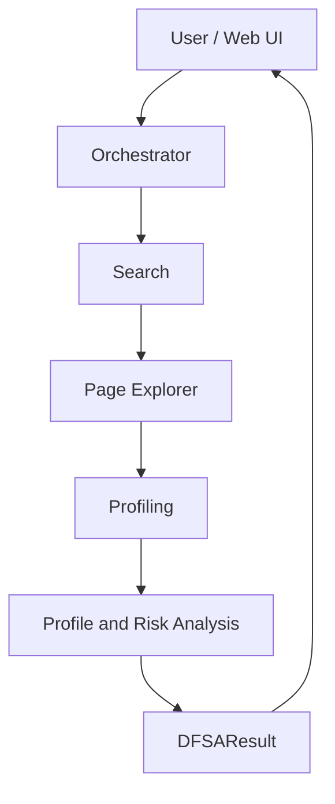

# DFSA v0.2 팀 개발 명세서

- Project: Digital Footprint Security Alert (DFSA)
- Document version: v0.2
- Status: PR #14 팀 승인 및 `main` 병합 시 Contract Freeze (§12)
- v0.1 구현 기준: main `285e55865b81e97243a03afdf5a6d3fd42d023c0`
- 기존 v0.1 명세: [team-development-spec-v0.1.md](team-development-spec-v0.1.md)

## 1. 목적 및 MVP 범위

최소한의 개인정보로 본인 또는 명시적으로 동의한 대상의 공개 연구실 웹사이트를 검색하고, 승인 범위 내 페이지를 탐색해 확인된 공개 정보와 관계를 시각화한다. 공개 정보 노출이 사회공학적 사칭 위험으로 이어질 수 있음을 교육하고 대응 방안을 제시한다.

v0.1은 실제 A/B/C와 Orchestrator의 Offline E2E를 검증했다(PR #11). 당시 기록은 Offline E2E 89 passed, 전체 1301 passed / 1 failed(기존 Windows CRLF fixture 문제)였다. 이후 팀 Live 테스트에서는 검색 결과 0건 및 SEARCH_API_ERROR, 직접 프로필 분석에서 uncertain/no_name_match가 발생했다. 세부 원인은 확정되지 않았다. v0.2의 목표는 실제 검색 및 웹페이지를 통한 end-to-end 결과 시연이다.

### P0
- 이름 + 학교(정식 명칭 또는 약칭) 입력, 이메일 선택.
- 기존 SerpApi를 이용한 실제 단일 검색어 검색. 최초 팀 내 시연은 동의한 ADSL 사례로 검증한다. 실제 검색 결과 없이 시작 URL을 삽입하여 성공처럼 처리하지 않는다.
- 검색으로 발견한 승인된 연구실 사이트에서 대상 본인의 정보 및 관련 조직 문맥을 여러 페이지에 걸쳐 확인한다. 개별 프로필 발견만으로 탐색을 종료하지 않는다.
- 검증된 Exposure/Evidence 기반 Profile 및 사용자 중심 Relationship Graph.
- 일반적인 사칭 위험에 대한 교육용 모의 사례와 대응 방안.
- Web UI에 검색, 탐색, 분석 결과, 실제 소요 시간 표시.
- 합성 fixture로 회귀 검증, 동의한 대상 및 승인된 사이트로 수동 Live E2E.

### P1 / Out of Scope
- P1: 추가 승인 연구실, 복수 검색어, 실시간 단계 업데이트, 그래프 상호작용 고도화.
- 제외: 범용 크롤러, SNS/외부 사이트 탐색, 타인 프로필 수집, 인증 우회, PDF/OCR, 지속 모니터링, DB, 공개 배포, 공격 성공 확률 및 위험 점수, 실제 인물에 대한 발송 가능한 피싱 메시지 생성·발송, 정량적 Precision/Recall/F1 평가.
- Live 실행은 팀의 승인된 로컬 시연으로 제한한다. 입력만으로 임의 제3자 분석을 허용하지 않는다.

## 2. 최종 결과물

| 결과 | 책임 | 의미 |
| --- | --- | --- |
| Search History | A | 실제 검색어, 입력 정보의 조합, 실행 상태 |
| Discovered Sources | A | 검색 API가 반환하여 선택된 URL 및 발견 근거 |
| Navigation History | Explorer | 실제 접근/발견 경로 및 처리 결과 |
| Personal Profile | C | 검증된 공개 정보에 대한 사용자 중심 요약 |
| Relationship Graph | C | 직접 근거가 있는 사용자·조직·학술 관계 |
| Phishing Risk Scenario | C | 일반적인 위험 설명과 실제 인물과 분리된 교육 사례 |
| Security Recommendation | C | 발견된 노출 유형에 따른 방어 수칙 |
| Execution Time | Orchestrator | 전체 및 단계별 실제 실행 시간 |

내부 Source, Exposure, Evidence 및 상태·오류도 최종 데이터에 유지한다. UI는 별도의 필수 결과 화면으로 모두 나열할 필요는 없으나 Profile 및 Graph에서 근거를 확인할 수 있어야 한다.

## 3. Component, Ownership 및 Architecture

| Component | Owner | 책임 |
| --- | --- | --- |
| A — Search | 정유채 | 검색어, Provider, URL 정규화·중복 제거, 검색 관련성 및 이력 |
| Page Explorer | 서동균 | 기존 B의 Fetch/URL Policy/Parsing 분리, 제한적 페이지 탐색, 문서와 탐색 이력 전달 |
| B — Profiling | 서동균 | Rule+LLM 동일인 검증, 문맥 기반 Exposure 후보, 검증·병합 |
| C — Profile & Risk Analysis | 강영림 | 검증된 Exposure 기반 Profile, Graph, 교육용 위험 설명, 대응 방안 |
| Orchestrator | 서동균 | 요청, 호출 제어, 상태/오류/시간 및 결과 조합 |
| 공통 Contract | 서동균 + 팀 Review | 공유 모델, 검증 및 변경 관리 |
| Web UI 및 연결 | 정유채 | UI, API 연결 및 표현. 기술 선택/구현 상세는 담당자가 제안·수정 |
| 통합 및 시연 | 공동 | Offline/Live 검증 및 매뉴얼 |

논리적 데이터 흐름:



실제 호출은 Orchestrator가 각 Component를 독립적으로 호출하는 방식이다. A/E/B/C는 서로 직접 호출하지 않는다. 하나의 Python 애플리케이션 내 함수 호출을 유지하며 Explorer를 별도 서버로 분리하지 않는다. UI는 DFSAResult만 소비한다.

## 4. 공통 규칙 및 ID

- Python 3.12, Pydantic v2. Public Contract는 extra="forbid", validate_default=True. 내부 문서 전달은 별도 typed Python 모델로 관리하며 JSON/UI로 원문 전체를 보내지 않는다.
- Public request/response는 schema_version: Literal["v0.2"], request_id: str. v0.1 실행·회귀 검증의 임시 격리 정책은 §12를 따른다.
- 명시된 Optional 필드는 생략 가능하며 기본 null. 응답의 collection은 기본 [] 및 항상 직렬화, 필수 summary/stages/time은 생략 금지. 필수 요청 배열은 별도 명시. ID는 요청 내 고유하고 빈 문자열 금지.
- ErrorDetail 유지: code: str, message: str, retryable: bool, source_id: str|null=null, query_id: str|null=null. 키·개인정보·원문·외부 응답 및 raw exception을 오류 메시지에 넣지 않는다.
- ModuleStatus: success, partial_success, failed. StageStatus는 동일 값 + not_started. 정상 0건은 성공 가능, 실패가 있는 경우 사용 가능한 결과가 있어야 partial_success. 예상치 못한 프로그래밍/계약 오류는 명시적으로 실패시키며 정상 결과로 숨기지 않는다.
- ID Ownership: Orchestrator request_id; A query_id(q_*) 및 검색 source_id(src_*); Explorer 새 페이지 source_id(nav_src_*)와 navigation_id(nav_*); B exposure_id(exp_*); C node_id(node_*), edge_id(edge_*), scenario_id(scenario_*), recommendation_id(rec_*). 하나의 페이지에 같은 ID를 재사용하며 namespace 충돌 금지.
- 원문 근거 경로: Profile/Graph → exposure_id → Exposure.sources → source_id → 실제 URL/Evidence → navigation 기록 → search 결과/Query.
- v0.2에서 RiskPath, RiskPathStatus, RiskEvaluation, EvaluationValue, risk_path_id, 기존 RiskCategory Public Enum, RiskRequest/RiskResponse 및 위험 경로 요약 필드는 제거한다. 기존 위험 분석 템플릿은 방어 교육용으로 필요 시 재사용한다.

## 5. Subject 및 Module A

### 5.1 입력 계약

Subject (공통):
| Field | Type | Required / Default |
| --- | --- | --- |
| name | str | required, trim 후 non-empty |
| organization | str | required, trim 후 non-empty; 대학명 또는 학교 약칭 |
| email | EmailStr \| null | optional, null |

학교 별칭은 검증된 학교 단위 매핑을 사용할 수 있다. 사용자 이름, 이메일, 소속을 추측하여 생성하지 않는다. 이메일 미입력 시 문자열 "None"을 검색·비교에 사용하지 않는다. 동의/승인 확인은 분석 실행 전 애플리케이션 정책에서 처리하며 공개 임의 검사 API를 제공하지 않는다.

SearchRequest = RequestContract + subject: Subject + options: SearchOptions(default top_k=10, strict int 1~20).

### 5.2 검색 정책
- P0: 입력 name + 공백 + organization을 사용한 단일 비인용 검색어. 이메일은 선택 입력이더라도 P0 기본 검색어에 포함하지 않는다.
- Provider는 기존 SerpApi. 정규화·중복 병합 및 후보 관련성 코드 재사용. 관련성 후보는 최종 동일인 판정이 아니다.
- 승인 사이트에 해당하는 결과를 Explorer 시작점으로 삼는다. 도메인 allowlist는 접근 권한을 제한하는 설정이며 검색 결과를 만들어내는 데이터로 사용하지 않는다.
- SearchResponse의 기존 필드 유지: status, searched_at(UTC aware datetime), queries: QueryExecution[], results: SearchResult[], errors: ErrorDetail[].
- QueryExecution: query_id, text, provider, status(success/failed), input_fields: list[str](실제 사용한 Subject 필드; P0 ["name","organization"]).
- SearchResult: source_id, url(실제 반환 원본), normalized_url, title:str|null, snippet:str|null, rank:int, relevance:{status:candidate/uncertain,reasons:list[RelevanceReason]}, discovered_by:list[{query_id,provider_rank:int|null}]. 기존 relevance enum 유지.
- 각 SearchResult의 `discovered_by`는 같은 응답에 기록된 Query를 참조하며, 성공한 Query를 하나 이상 포함한다. 성공·실패 Query가 함께 기록된 경우는 허용한다.
- SearchResponse는 오류나 실패 Query가 없으면 0건도 `success`다. 오류 또는 실패 Query와 사용 가능한 결과가 함께 있으면 `partial_success`, 사용 가능한 결과가 없으면 `failed`다. 실제 A runner의 v0.2 전환은 §12의 Module A 기능 PR에서 진행한다.
- 검색 snippet은 실제 페이지 원문 Evidence가 아니다.

## 6. Page Explorer

### 6.1 책임과 탐색 목표

단순히 Homepage → People → Profile 한 경로를 찾는 모듈이 아니다. 검색에서 발견한 승인된 연구실 웹사이트 내에 흩어진 대상 본인의 정보와 연구실·학교의 관련 공개 문맥을 여러 페이지에 걸쳐 확보할 수 있도록 제한된 탐색을 수행한다. 대상 프로필을 발견하더라도 허용 범위 내 관련 페이지 탐색을 이어갈 수 있다. 여러 seed 및 분기 경로를 지원한다. 예: 가상 구조에서 A → A-1, A → A-2 및 A-1 → A-1-a. 특정 URL 패턴의 실제 존재를 전제하지 않는다.

사이트 전체의 개인정보를 수집하는 범용 크롤러가 아니며, 관련 없는 구성원 개별 프로필, 연락처 목록의 별도 수집, 외부 계정 추적은 제외한다. 조직 문맥 페이지는 대상 본인 정보의 귀속 검증에 필요한 경우에만 사용하며, 같은 연구실이라는 사실만으로 지도 관계 등을 만들어서는 안 된다.

### 6.2 초기 운영 정책 (설정값; 담당자가 테스트 후 팀 합의로 조정)

- 승인된 정확한 HTTPS host 및 허용 페이지 범위만 사용. 실제 검색 결과에서 승인 범위에 속하는 URL이 seed가 된다.
- 기본 최대 깊이 3(seed=0), 전체 요청 최대 30개 페이지 접근 시도, redirect 포함 실제 HTTP 요청 상한 40회, 페이지 timeout 10초, 응답 최대 2 MiB, 전체 탐색 deadline 초기 90초. 제한값은 성능 검증 결과가 아니라 초기 설정.
- 범위 내 공개 HTML, 실제 문서 링크만 사용. 외부 도메인, 비HTTP(S), 인증 필요, robots/사이트 이용 제한 위반, 무관한 개별 인물 페이지 등은 제외한다. 무한 탐색이나 실패 무한 재시도 금지.
- 기존 URL 보안(SSRF 방어, 공개 DNS/IP, 연결 대상 검증, TLS, redirect 매 hop 검증, body limit, proxy 정책)을 유지한다. 기존 Live runner와 production fetch의 보호 수준이 같은지 검증 후 연결한다.
- 분기 탐색 순서 및 link selection은 결정적 정책으로 처리하고, 방문 URL/redirect 중복과 요청 한도를 관리한다. 프로필 발견 여부가 종료 조건은 아니다. 승인된 관련 후보 소진 또는 정책 한도 도달 시 종료하고 제한으로 중단되었음을 기록한다.
- 원본 HTML은 요청 내에서만 보유, B에서 다시 fetch하지 않는다. 웹페이지 콘텐츠는 명령이 아닌 데이터이다.
- 라이브러리 사용 여부는 Owner가 정하되 기존 원문 보존/offset/블록 계층 및 링크 추출 기능과 보안 정책을 회귀 검증한다.

### 6.3 내부 계약

ExplorationRequest = RequestContract + subject: Subject + search_results: list[SearchResult] (required). 접근 정책 및 자원 제한은 서버 설정이며 UI가 임의로 바꾸지 않는다.

기존 ParsedDocument, ParsedBlock, ParsedText, ParsedLink, ParsedMetadata를 공유 내부 모델로 이동/재사용한다. ParsedDocument에는 기존 source_id, original_url, final_url, encoding, html_text, title, metadata, blocks, texts, links를 유지한다. 원문 위치 및 block/text 참조 의미 유지. 문서 한 건은 동일 요청의 하나의 source_id에 대응한다.

NavigationEntry (Public metadata):
| Field | Type |
| --- | --- |
| navigation_id | str |
| source_id | str |
| parent_source_id | str|null (seed는 null) |
| root_source_id | str (A의 검색 결과 ID) |
| url | str (발견 URL) |
| final_url | str|null |
| depth | int >= 0 |
| status | success / fetch_failed / parse_failed / unsupported / blocked / skipped |
| reason | str|null |

seed의 `source_id`와 발견 `url`은 A의 SearchResult와 일치해야 한다. 한 `source_id`의 여러 기록은 같은 페이지를 가리키며, 확인된 redirect 별칭이나 복수 경로는 재요청 없이 같은 ID에 기록할 수 있다. 스킵한 경로는 이미 확인된 별칭만 재사용한다. `success`에는 검증된 절대 HTTP(S) `final_url`이 필수이며, redirect가 없는 경우에도 실제 확보 URL을 기록한다. 이 값은 확보 문서의 `final_url` 및 B의 공개 `Source.url`과 일치해야 한다. 차단된 미방문 기록은 Exposure의 출처가 될 수 없다.

ExplorationResult (typed internal envelope):
- schema_version, request_id, status: ModuleStatus
- documents: tuple[ParsedDocument,...] (기본 empty, 성공적으로 확보한 문서)
- navigation_history: list[NavigationEntry] (기본 [])
- errors: list[ErrorDetail] (기본 [])
- limit_reached: bool, 기본 false
- attempted_source_ids: tuple[str, ...] (기본 empty, 실제 페이지 요청을 시도한 source_id, 내부 전용)

시도 ID는 같은 결과의 탐색 이력에 `skipped` 이외의 기록이 있어야 한다. `success`, `parse_failed`, `unsupported`의 source_id는 시도 ID에 포함한다. `fetch_failed`와 `blocked`는 실제 요청 여부를 기준으로 기록한다. 요청 전 실패·차단은 시도에 포함하지 않으며, 요청 뒤 redirect 차단은 시작 페이지의 ID를 포함한다. `visited_page_count`는 고유 시도 ID 수이며 redirect hop은 별도 페이지로 세지 않는다. 공개 결과에서 방문 수는 요청이 확실한 고유 페이지 수 이상, `skipped` 이외의 기록이 있는 고유 페이지 수 이하로 검증한다.

기술적 실패는 `errors` 또는 탐색 이력의 `fetch_failed`, `parse_failed`, `unsupported`로 확인한다. 확보 문서와 기술적 실패 또는 한도에 의한 미완료가 함께 있으면 `partial_success`, 기술적 실패만 있으면 `failed`다. 정책상 제외만 있었으면 정상 0건이 가능하다.

## 7. Module B — Profiling

### 7.1 계약
ProfilingRequest = RequestContract + subject: Subject + documents: tuple[ParsedDocument,...] (required; 내부 모델, JSON 원문 전달 불필요).
ProfilingResponse = RequestContract + status: ModuleStatus + sources: list[Source] + exposures: list[Exposure] + errors: list[ErrorDetail].

Source: source_id, url (검증한 실제 최종 URL), processing_status(success/fetch_failed/parse_failed/unsupported/rejected), identity_status: IdentityStatus|null=null. Explorer 실패 정보는 navigation_history에 남기고 B는 전달된 문서를 판단한다.
IdentityStatus: confirmed, uncertain, rejected. 동일인 판정 전 null, 판정 완료 후 enum. 확정은 시스템의 근거 기반 귀속 판단이며 법적 본인 인증을 의미하지 않는다.

Orchestrator는 반환된 Source의 ID와 실제 URL을 입력 문서와 대조한다. `success`는 모든 입력 문서에 대한 Source와 완료된 동일인 판정을 요구한다. `uncertain`, `rejected`, Exposure 0건은 정상 처리 결과에 포함된다. `partial_success`에서 Source를 반환하지 못한 문서는 해당 `source_id`의 오류로 기록한다. 단계 전체가 `failed`인 경우 사용할 수 있는 Exposure가 없으며 후속 분석을 생략한다.

Exposure 유지/확장:
| Field | Type / Policy |
| --- | --- |
| exposure_id | str, B 생성 |
| type | ExposureType (identity/contact/affiliation/relationship/activity/interest/account/temporal) |
| value | str, non-empty |
| subtype | str|null, default null; 아래 제한된 의미 |
| relation | str|null, default null; 관계의 명시적 의미 |
| sources | list[ExposureSource], min_length=1 |

ExposureSource: source_id: str, evidence: str(non-empty). 모든 참조는 B가 처리·검증한 confirmed Source에 연결되어야 한다. 기존 EvidenceReference/ValidatedExposureCandidate와 원문 위치를 내부에서 재사용한다. 내부 diagnostic 및 원문 HTML은 공개 응답에 포함하지 않는다.
최소 subtype: identity/name, identity/role, affiliation/university, affiliation/laboratory, contact/email, relationship/advisor. 기타는 null 허용. type과 subtype 조합 불일치는 거부하고 확장 시 팀 합의. relation=advisor는 명시적 지도 근거가 있는 경우만 허용한다.

### 7.2 Rule + LLM Hybrid

- 기존 Rule-based 동일인 검증, 명시적 필드 추출 및 Evidence 검사와 LLM의 문맥 해석을 함께 사용한다. Rule-only 또는 LLM-only로 전체를 교체하지 않는다.
- LLM은 이름 병기/문맥, 동일인 후보, 대상 인물 영역, 문맥 기반 Exposure 후보 및 명시적 관계 후보를 보조한다. ST3는 학교 Mindlogic Gateway의 [OpenAI 호환 Chat Completions](https://docs.mindlogic.ai/docs/ssu/api-gateway/reference/chat-completions)와 JSON Schema를 사용한다. 모델별 호환성은 합성 파일럿에서 확인한다.
- B Owner가 학교 API 문서, 인증, endpoint, 허용 모델, 데이터 전송 조건 및 응답 형식을 확인 후 SDK/HTTP client를 정한다. 설정은 환경변수 또는 로컬 설정으로 관리하고 키는 저장소/UI/로그에 노출하지 않는다. 실제 연동 정보 미확인은 P0 구현 전 확인 사항이다.
- LLM 응답은 내부 typed candidate schema로 변환·검증하고 기존 문서의 실제 text/block 참조 및 원문 근거와 일치해야 한다. 출력 문자열이 문서 어딘가에 있다는 것만으로 귀속을 확정하지 않는다.
- 확정 조건은 대상 이름 표현과 독립적인 소속/입력 이메일 등 충분한 근거 및 같은 인물 영역의 정보 귀속이다. 페이지 전체 조직명이나 도메인 단독으로 확정하지 않는다. 이름/소속이 같더라도 혼동 가능성이 있으면 uncertain. 사용자 확인이 필요한 경우 별도로 본인/동의 및 후보 귀속을 확인하고 재검증하며 확인 없는 uncertain은 공식 Exposure에 포함하지 않는다. UI 후보 확인 기능의 구현 상세는 UI/B 담당 합의; P0에서 미구현이라면 uncertain으로 안전하게 종료한다.
- 다중 페이지의 조직 문맥은 별도 원문 근거로 참조할 수 있으나 사용자와의 명시적 연결을 확인하지 못한 조직/인물 정보는 Profile에 합치지 않는다. 다른 사람의 정보는 제외하고 불필요한 원문을 학교 API에 전송하지 않는다.
- LLM에 네트워크 접근, 실행 도구, 비밀값 또는 임의 사이트 탐색 권한을 부여하지 않는다. 웹 콘텐츠의 지시문은 무시한다. timeout, 제한된 호출량 및 오류 처리 정책을 설정한다. 초기 제안: 요청당 최대 10회, 호출 timeout 20초, 단계 deadline 90초(담당자 검증 후 조정). 실제 API 이용 조건 확인 전 실개인정보를 외부 전송하지 않는다.
- 실패 시 독립적으로 검증 가능한 Rule 결과만 유지하고 오류/부분 처리 사실을 기록한다. 근거 부족은 uncertain, 명확한 불일치는 rejected; 환각 후보는 폐기. 기존 deduplication은 type/subtype/value/relation과 복수 근거를 일관되게 처리하도록 보완한다.
- 정상 문서 분석 결과 0 Exposure는 success 가능. 일부 기술적 실패 + 사용 가능한 처리 결과는 partial_success, 모두 처리 불가 시 failed. B는 Network fetch를 수행하지 않는다.

## 8. Module C — Profile & Risk Analysis

AnalysisRequest = RequestContract + subject: Subject + exposures: list[Exposure] (default []). 오직 B의 검증된 Exposure를 이용하며 직접 웹 접근, 동일인 재판정, 새로운 사실 추론을 하지 않는다.
AnalysisResponse = RequestContract + status: ModuleStatus + personal_profile: PersonalProfile|null + relationship_graph: RelationshipGraph + phishing_risk_scenarios: list[PhishingRiskScenario] + security_recommendations: list[SecurityRecommendation] + errors: list[ErrorDetail].
응답 상태는 오류가 없으면 `success`, 오류와 사용 가능한 결과가 함께 있으면 `partial_success`, 오류만 있으면 `failed`다. 결과 유무는 Profile의 존재 또는 Graph 노드·시나리오·대응 방안의 유무로 판단한다.
Profile/Graph는 결정적 규칙 기반. C의 세부 구현은 Owner 자율. 기존 RiskPath 필수 규칙, 5항목 평가, score/rank 및 기존 R01~R05 충족 조건은 폐기한다.

### 8.1 PersonalProfile

ProfileItem: label:str, value:str, exposure_ids:list[str] (non-empty), 필수.
PersonalProfile:
- name, university, laboratory, role, contact, research_interests, academic_relationships, activities: list[ProfileItem], 각 기본 []
- additional: list[ProfileItem], 기본 [] (위에 분류되지 않은 검증 Exposure).

입력 subject는 Profile의 발견 결과와 별도 표시한다. 웹에서 검증된 값만 ProfileItem으로 구성한다. 빈 항목은 미확인이지 실제 정보가 없다는 단정이 아니다. 연락처 등 개인정보는 UI에서 기본 마스킹한다.

### 8.2 RelationshipGraph

RelationshipGraph: nodes:list[GraphNode], edges:list[GraphEdge], 각각 기본 [].
GraphNode: node_id:str, label:str, kind: person/university/laboratory/research_topic/activity, origin: input/verified, exposure_ids:list[str].
GraphEdge: edge_id:str, source_node_id:str, target_node_id:str, relation: AFFILIATED_WITH/MEMBER_OF/ADVISED_BY/INTERESTED_IN/PARTICIPATED_IN, exposure_ids:list[str] (non-empty).

사용자 중심 1-hop만 P0. 중심 노드는 입력 subject이며 origin=input, exposure_ids=[] 가능. 그 외 노드 및 모든 edge는 검증된 Exposure를 참조한다. 연구실 소속만으로 지도교수를 추정하지 않는다. 관련 없는 사람의 연락처나 관계망을 추가하지 않는다. 그래프 레이아웃은 UI가 담당하며 DB/그래프 DB는 불필요하다.

### 8.3 교육 및 대응

PhishingRiskScenario: scenario_id:str, title:str, explanation:str, educational_example:str, exposure_types:list[ExposureType] (non-empty), safety_checks:list[str] (non-empty).
SecurityRecommendation: recommendation_id:str, title:str, description:str, exposure_types:list[ExposureType] (빈 배열은 일반 수칙).

시나리오와 유형별 대응 방안의 `exposure_types`는 B가 검증한 Exposure에서 실제로 발견된 유형만 참조한다. 일반 대응 방안은 빈 목록을 사용할 수 있다.

노출 유형 기반의 방어 교육용 Rule + Template을 사용한다. 실제 인물과 분리된 합성 사례로 사칭 위험을 설명하고 공식 채널 확인 등 방어 방법을 제공한다. 실제 대상의 이름·이메일·관계 등을 결합한 공격용 콘텐츠, 발송 가능한 이메일 문안, 공격 성공률 예측을 생성하지 않는다. C에 LLM을 필수 도입하지 않는다. 교육 설명은 해당 정보 유형이 실제로 발견되었을 때 제공하되 구체적인 개인 데이터는 삽입하지 않는다. 대응 방안은 노출 유형에 맞추고 중복 제거한다.

정상 처리 결과에서 해당 정보/관계가 없으면 빈 배열을 반환하며 임의 데이터를 추가하지 않는다. 빈 입력 독립 호출 시 빈 Profile/Graph 및 일반 수칙 반환 가능하되 정상 pipeline에서 B Exposure 0건이면 C를 생략한다.

## 9. Orchestrator / 최종 DFSAResult

### 9.1 진입점

```python
run_search(request: SearchRequest) -> SearchResponse
run_exploration(request: ExplorationRequest) -> ExplorationResult
run_profiling(request: ProfilingRequest) -> ProfilingResponse
run_analysis(request: AnalysisRequest) -> AnalysisResponse
run_pipeline(subject: Subject) -> DFSAResult
```

애플리케이션 시작 시 callable을 연결한다. 승인 및 동의 확인은 호출 이전에 수행한다. 테스트는 동일 callable 경계에 mock을 연결한다. Orchestrator는 각 요청 생성, 참조 무결성 검증, 단계 제어 및 결과 집계만 하며 C 내용을 재생성하지 않는다.

### 9.2 Public UI 계약

DFSAResult:
| Field | Type / Default |
| --- | --- |
| schema_version | Literal["v0.2"] |
| request_id | str |
| status | ModuleStatus |
| subject | Subject |
| stages | Stages (required) |
| search_history | list[QueryExecution], [] |
| discovered_sources | list[SearchResult], [] |
| navigation_history | list[NavigationEntry], [] |
| exploration_limit_reached | bool, false |
| sources | list[Source], [] |
| exposures | list[Exposure], [] |
| personal_profile | PersonalProfile|null, null |
| relationship_graph | RelationshipGraph, empty nodes/edges |
| phishing_risk_scenarios | list[PhishingRiskScenario], [] |
| security_recommendations | list[SecurityRecommendation], [] |
| execution_time | ExecutionTime (required) |
| summary | ResultSummary (required) |
| errors | list[ErrorDetail], [] |

Stages: search, exploration, profiling, analysis (StageStatus 각각 required).
ExecutionTime: total_ms: float >=0, search_ms/exploration_ms/profiling_ms/analysis_ms: float|null (각 required, 실행하지 않았으면 null). time.perf_counter()로 실제 backend pipeline 경과 측정. total은 Orchestrator overhead 포함, UI 렌더링 시간은 제외. 음수/NaN/inf 금지.
ResultSummary: search_result_count, visited_page_count(실제 요청을 시도한 고유 페이지 수; redirect hop은 별도 HTTP 상한에 포함), confirmed_source_count, total_exposures, total_graph_nodes, total_graph_edges, total_scenarios, total_recommendations (각 int>=0, required).

### 9.3 제어와 상태

| 상황 | 후속 실행 | Overall |
| --- | --- | --- |
| A failed | E/B/C 생략 | failed |
| A 정상 0건 | E/B/C 생략 | success |
| E failed | B/C 생략 | failed |
| E 정상 0문서 | B/C 생략 | success 또는 upstream partial |
| B failed | C 생략 | failed |
| B 정상 0 Exposure | C 생략 | success 또는 upstream partial |
| C failed (검증 Exposure 존재) | 결과 보존 | partial_success |
| 실행 단계 partial_success 존재, 후속 치명 실패 없음 | 사용 가능한 입력이 있으면 진행 | partial_success |
| 모든 실행 단계 정상 | - | success |

실제 실행한 단계 상태를 유지하며 미실행은 `not_started`로 기록한다. DFSAResult는 공개 검색 결과, 성공한 탐색 기록, 검증된 Exposure를 기준으로 후속 단계의 실행 여부를 검증한다. A/E/B의 실패는 전체 실패이고, C 실패는 앞선 결과를 보존해 부분 성공으로 처리한다. 오류는 단계 순서로 수집하고 모든 필드가 같은 항목만 병합한다. 성공 상태와 MVP 성공 조건은 구분한다.

## 10. Web UI 및 기술 선택

- 초기 추천: React + TypeScript + FastAPI/Uvicorn, React Flow 등 그래프 시각화 라이브러리. 정유채 담당자가 기술/구조/API 경로를 개발 편의에 맞게 직접 조정하고 공통 JSON 계약 영향이 있는 변경은 팀과 합의한다. 이 PR에서는 UI 파일을 만들거나 수정하지 않는다.
- P0: Loading 후 결과 일괄 표시. Search History, Discovered Sources, Navigation History, Personal Profile, Relationship Graph, Phishing Risk Scenario, Security Recommendation, Execution Time을 확인 가능해야 한다.
- 실패/부분 성공/미실행/0건을 구분하고 확인된 근거 및 탐색 제한을 명시한다. 연락처 기본 마스킹, 근거 열람은 승인된 시연 대상에 한정한다. 원문 HTML을 렌더링하지 않고 untrusted text를 escape한다.
- API 키·내부 원문·민감 로그는 frontend로 보내지 않는다. 동의/승인 및 접근 범위는 서버에서 강제한다. 요청 단위 메모리 처리, 브라우저/서버에 개인정보 영구 저장 금지, 새 요청과 이전 요청의 상태 격리.

## 11. 라이브러리 및 데이터 보호 원칙

v0.1의 외부 라이브러리 최소 사용 방침을 v0.2에서 완화한다. 적합한 오픈소스 라이브러리를 적극 검토하여 직접 구현 비용을 줄인다. 단 이미 검증된 코드를 교체할 때는 이유 및 회귀 테스트를 갖춘다.

- 공통: 기존 Pydantic/pytest 유지. HTTPX, Beautiful Soup/lxml, 환경설정 라이브러리, Graph/UI 라이브러리 등은 필요에 따라 Owner가 선택. 학교 API SDK는 실제 문서 확인 후 결정. 이 문서는 특정 신규 dependency 설치를 확정하지 않는다.
- 라이선스, Python/Node 버전 호환, 유지보수, 보안, 재현 가능성 검토. requirements 및 frontend manifest/lockfile로 공유하고 변경 PR에 이유를 기록한다.
- 원문 offset, 동일인 귀속, SSRF/redirect/응답 제한 등 프로젝트 고유 검증을 약화시키지 않는다.
- 학교 API/SerpApi의 실제 데이터 전송·이용 조건 확인 및 대상 동의가 Live 사용의 선행 조건이다. 검색어/문서의 필요 최소 정보만 전달하고 키/실개인정보/원문 응답을 공개 저장소, fixture, 로그에 저장하지 않는다. 교육 사례 및 테스트에는 합성 데이터만 사용한다.

## 12. Repository 변경 및 개발 순서

v0.2 계약과 모듈 경로:
```text
src/dfsa/
  contracts/        common.py, search.py, exploration.py, profiling.py, analysis.py, result.py
  modules/
    search/
    explorer/
    profiling/
    risk/           # C 담당자가 내부 이름/구조 조정 가능
  service/         orchestrator.py
  _documents.py    # Explorer와 B의 공유 내부 문서 타입
tests/
  contract/
  integration/
  modules/{search,explorer,profiling,risk}/
  e2e/
frontend/          # UI 담당자 소유 예정
```

| 순서 | PR | Owner | 완료 조건 |
| --- | --- | --- | --- |
| 1 | v0.2 문서/설계 | 서동균 + 팀 Review | 방향·책임·계약 Review |
| 2 | B Fetch/Parsing 구조 분리 | 서동균 | v0.1 동작/계약 유지, 기존 회귀 검증 |
| 3 | v0.2 Contract + Orchestrator | 서동균 + 팀 Review | 신규 타입/fixture/Mock 통합, C 명칭/상태 교체 |
| 4 | A / Explorer / B / C 기능 | 각 Owner | 독립 테스트, Explorer와 B는 동일 Owner |
| 5 | UI/API 연결 | 정유채, Orchestrator 협업 | DFSAResult 기반 결과 화면 |
| 6 | Offline/Live E2E + 매뉴얼 | 공동 | 실제 시연 성공, 실패 경로 검증 |

계약과 Orchestrator를 검증한 PR #14가 팀 승인 후 `main`에 병합되는 시점에 Contract Freeze를 적용한다. 이후 공유 field/enum/ID/의미 변경은 팀 합의 및 fixture/test 수정과 함께 PR로 수행한다. UI는 합의된 Mock DFSAResult로 병렬 개발할 수 있다. 기능별 브랜치를 사용하고, `main` 직접 수정 금지와 What/Why/Test PR 및 리뷰 정책을 유지한다.

`dfsa._v01`은 기존 실행과 회귀 검증을 위해 계약과 Orchestrator를 임시로 격리한 영역이다. 신규 v0.2 개발은 `dfsa.contracts`와 `dfsa.service`를 사용한다. 모든 모듈의 v0.2 전환과 회귀 검증이 끝나면 임시 영역 제거를 검토한다.

## 13. 테스트 및 Definition of Done

- Contract: v0.2 버전, 이메일 null, enum, required/default, JSON round-trip, ID 참조 무결성, 원문 근거 필수, graph edge 참조, empty/failed 결과, 시간 및 summary 검증.
- A: 단일 검색어 실제 요청, None 문자열 미생성, 정상 0건/오류 구분, 중복/검색 이력 보존.
- Explorer: 합성 분기 사이트의 여러 승인 문서 확보, 프로필 발견 후에도 허용 후보 처리, 방문 중복 및 redirect, 깊이/페이지/시간 제한, 차단·실패 이력, 보안 정책, B 재fetch 없음.
- B: 이름 표기 차이, 이메일 없음, 동명이인/복수 인물 분리, Rule/LLM 결과 불일치, 환각/잘못된 인물 근거, 원문 참조 및 dedup, LLM API 실패/timeout 및 prompt injection 데이터 처리.
- C: 검증 Exposure만 사용, Profile/Graph의 근거 참조, 빈 항목/지도 관계 추정 방지, 합성 교육 사례 및 대응 방안.
- Orchestrator/UI: 모든 단계 및 조기 종료, 결과 보존, 시간 및 상태, 입력/발견 구분, UI 8개 결과, 데이터 격리.
- 기존 CRLF fixture 실패는 별도 수정으로 다루며 테스트 skip/xfail이나 assertion 완화로 숨기지 않는다. v0.2 공개 계약 테스트는 Analysis 결과를 검증하고, 기존 RiskPath 검증은 v0.1 회귀 테스트로 보존한다.
- Offline E2E는 실제 모듈과 fake 외부 의존성을 이용하며 실제 네트워크/API key 불필요. Live E2E는 별도 opt-in 및 승인 정책으로 실행한다. Precision/Recall/F1 등 정량 Evaluation은 요구하지 않는다.

### MVP Acceptance Criteria
1. 동의된 대상의 이름+학교 입력으로 실제 SerpApi 검색이 수행되고 승인 연구실 결과를 얻는다.
2. 검색 결과를 seed로 승인 범위 내 관련 문서를 제한적으로 탐색하고 실제 경로를 남긴다. 페이지가 여러 개면 분기 탐색도 검증한다.
3. 이메일 미입력 상태에서 원문과 근거에 기반한 대상 정보 확인 및 유효 Exposure를 생성한다. 잘못된 인물·근거 없는 관계는 제외한다.
4. Profile 및 중심 노드 외 하나 이상의 검증된 관계 Edge를 구성한다. 실제로 근거가 없으면 실패/미달로 기록하고 가짜 관계를 생성하지 않는다.
5. 일반 교육용 사칭 위험 사례와 대응 방안을 제공한다.
6. UI에 8개 결과 및 실제 단계별/전체 소요 시간 표시, 실패/제한/0건 구분, 근거 추적 가능.
7. 실제 Live 결과와 Mock을 구분한다. 하드코딩 URL, 가짜 Exposure/시간/관계, 임의 위험 경로로 성공을 연출하지 않는다.

## 14. Review 시 확인할 구현 선행 사항

- ST3에서 학교 Gateway의 내부 Adapter를 제공한다. 학교 계정의 개별 모델 가용성과 실제 차감액은 합성 파일럿으로 확인한다. 실개인정보 처리 조건은 별도 확인이 필요하다.
- Explorer의 초기 제한(깊이 3, 30페이지, 40 HTTP 요청 등) 및 LLM 초기 제한은 설계 제안값으로, 승인 범위 및 실제 소요 시간을 확인한 후 팀 Review에서 조정한다. 실제 대상 사이트 전체 크기/Live 성공을 보장하지 않는다.
- UI 담당자가 추천 스택과 상세 UI/API 방식 수정 가능. 불확실한 동일인 후보 확인 UX 미구현 시 공식 결과에서 제외한다.
- 기존 실행은 후속 기능 PR에서 단계적으로 v0.2로 전환한다. v0.1 명세와 회귀 검증은 전환 기간의 기준으로 보존한다.

## 15. 기존 명세 대비 변경 요약

| v0.1 Section | v0.2 대응 |
| --- | --- |
| §1–5 | §1–3: 목적·역할·흐름 변경 |
| §6–10 | §4–5: 공통 규칙 유지 및 Subject/검색 수정 |
| §11–17 | §6–7: Explorer 분리, Hybrid B, 출처 계약 확장 |
| §18–22 | §8: RiskPath 중심 계약 제거 및 Analysis 계약 신설 |
| §23–25 | §9: Orchestrator·최종 계약 확장 |
| §26–30 | §4/11/12: Contract 및 의존성, fixture/변경 정책 유지 |
| §31–39 | §10/12/13: UI 및 단계별 개발, Live 기능 검증 |
| §40–42 | §3/4/9/11: Contract-first, 독립 모듈, 추적 가능성, 실패 명시 유지 |
